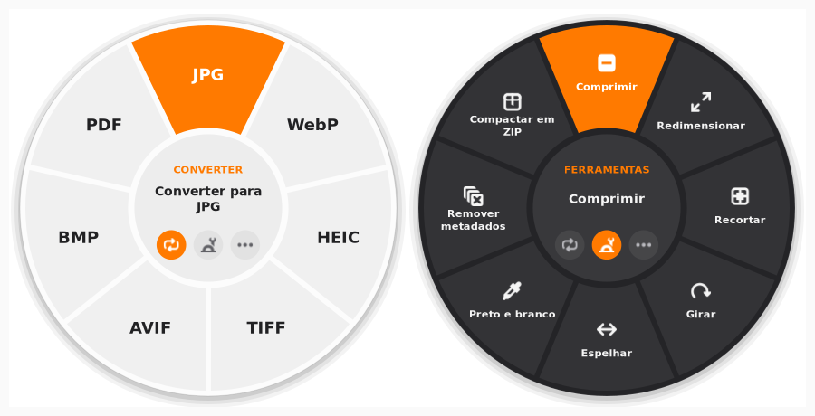
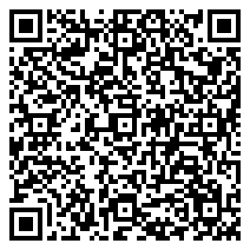

# Mexerica

Conversor de arquivos **offline** para o desktop Linux (GNOME), no espírito do
[Tangerine para Mac](https://tangerineformac.com/): arraste um arquivo, segure uma tecla e
solte na roda. Nada é enviado para a internet; tudo roda no seu computador.



Grátis e de código aberto. Se ele te ajudar, [um Pix de qualquer valor](#apoie-com-pix) ajuda
a manter o projeto, sem obrigação nenhuma.

## O que faz

| | Quantidade | Exemplos |
|---|---|---|
| **Converter** | 299 conversões | HEIC → JPG, MOV → MP4, MP4 → MP3, PDF → DOCX/XLSX/PPTX/Markdown, DOCX → PDF/EPUB, XLSX → CSV, SRT ↔ VTT, RAR → ZIP |
| **Ferramentas** | 30 | comprimir (imagem, vídeo, áudio, PDF), recortar, cortar trecho, dividir, juntar, girar, redimensionar, remover áudio, extrair quadros, proteger/remover senha de PDF, extrair arquivo compactado, compactar em ZIP |
| **Ações** | 6 | enviar ao celular (KDE Connect), flutuar, copiar, mover para…, copiar caminho, abrir no terminal |

Formatos por categoria:

- **Imagens:** JPG, PNG, WebP, HEIC, TIFF, AVIF, BMP (entrada e saída), SVG (só entrada), exportação para PDF.
- **Áudio:** MP3, M4A, WAV, FLAC, OGG, Opus, AIFF, WMA.
- **Vídeo:** MP4, MOV, MKV, WebM, AVI, WMV, GIF; extração de áudio para MP3/M4A.
- **PDF:** para DOCX, ODT, PPTX, XLSX (tabelas detectadas viram planilhas), JPG/PNG (todas as páginas, 300 DPI), EPUB, TXT, Markdown, HTML.
- **Documentos:** DOCX, DOC, ODT, Pages (entrada), Markdown, TXT, EPUB, RTF → DOCX, ODT, PDF, MD, TXT, EPUB, HTML, RTF.
- **Apresentações:** PPTX, PPT, ODP, Keynote (entrada) → PDF, JPG, PNG, PPTX, ODP.
- **Planilhas:** XLSX, XLS, ODS, CSV, TSV, Numbers (entrada) → XLSX, ODS, CSV, TSV, PDF. Planilhas com várias abas viram um CSV por aba.
- **Legendas:** SRT ↔ VTT, e TXT só com o texto.
- **Compactados:** ZIP, TAR, TAR.GZ, 7Z entre si; RAR só leitura.

O resultado fica **ao lado do original** (ou numa pasta escolhida nas Preferências) e
**nunca sobrescreve** nada: um nome repetido vira `foto (2).jpg`. Saídas com vários arquivos
(páginas de um PDF, partes de um áudio) vão para uma pasta, como `documento (PNG)/`.

## Como usar

**Arrastando, de qualquer lugar** (precisa da extensão do GNOME):
comece a arrastar um arquivo e segure **Shift** (Converter), **Ctrl** (Ferramentas) ou
**Alt** (Ações). A roda aparece sob o ponteiro e fica aberta até você soltar; solte sobre a
opção desejada. Soltar fora da roda cancela. As teclas mudam nas Preferências.

**Pelo teclado:** no Nautilus, selecione arquivos e pressione **F4**. Na janela do Mexerica,
escolha arquivos e pressione **Enter**. Na roda: **← →** escolhem, **Enter** aplica,
**Tab** troca de roda, **1–9** aplicam direto, **Esc** fecha.

**Na janela:** solte arquivos sobre a janela do Mexerica; a roda aparece ali mesmo.
Passe o ponteiro sobre os botões do centro para trocar de roda durante o arrasto.

**Pelo terminal:**

```bash
mexerica --list                                 # todas as conversões e ferramentas
mexerica foto.heic --to jpg
mexerica video.mov --to mp4 --output-dir ~/Vídeos
mexerica audio.mp3 --tool audio-trim --param start=0:30 --param end=1:15
mexerica a.pdf b.pdf --tool pdf-merge
```

Ferramentas com parâmetros (cortar trecho, senha, nível de compressão) abrem um diálogo
curto que lembra os últimos valores usados.

## Instalar

```bash
git clone https://github.com/Nicolas-Queiroz/Mexerica.git ~/Mexerica
~/Mexerica/install.sh
```

Sem `sudo`. Ele cria o ambiente virtual em `.venv` e instala para o seu usuário: o lançador
`~/.local/bin/mexerica`, o atalho no menu de aplicativos, o serviço D-Bus, o início automático
em segundo plano (para a roda abrir sem espera), a extensão do GNOME Shell e o script do
Nautilus com o atalho F4. Para atualizar depois: `git -C ~/Mexerica pull && ~/Mexerica/install.sh`.

**Depois de instalar, encerre a sessão e entre de novo:** no Wayland, o GNOME só carrega
extensões novas no login. Para remover tudo: `./uninstall.sh`.

Requisitos do sistema (o resto vem pelo `pip`, inclusive ffmpeg, pandoc e PyMuPDF):

| Pacote (Debian/Ubuntu) | Para quê |
|---|---|
| `python3-gi`, `gir1.2-gtk-4.0`, `gir1.2-adw-1` | interface (GTK 4 + libadwaita 1.5+) |
| `libreoffice` | documentos, planilhas e apresentações; Pages/Numbers/Keynote |
| `7zip` | ler RAR e 7Z, criar 7Z |
| `ghostscript` | compressão de PDF (sem ele, uma compressão mais simples) |
| `kdeconnect` ou a extensão GSConnect | ação Enviar ao celular |

GNOME Shell 46 a 49 para a extensão. Sem ela o app funciona igual, só não abre a roda no
meio de um arrasto feito em outra janela.

## Diferenças em relação ao Tangerine

- **AirDrop → KDE Connect.** "Enviar ao celular" usa os aparelhos pareados no KDE Connect/GSConnect.
- **Command → Ctrl/Alt.** A tecla Super é do GNOME, então as rodas usam Shift, Ctrl e Alt.
- **Pages, Numbers e Keynote só como entrada.** Não há como gravar esses formatos no Linux; a saída equivalente é DOCX/ODT, XLSX/ODS e PPTX/ODP.
- **Sem limite de conversões.**
- **Flutuar** abre uma pequena janela com os arquivos para arrastá-los depois; fica sempre visível graças à extensão.
- Gestos de toque não foram implementados.

## Como funciona

```
mexerica/
  core/            conversões, ferramentas e ações — sem interface, testável
    engines/       imagens (Pillow, pillow-heif), mídia (ffmpeg), PDF (PyMuPDF, pdf2docx),
                   documentos (pandoc + LibreOffice), planilhas, apresentações, legendas, compactados
  ui/              GTK 4 + libadwaita: a roda, a janela principal, preferências, tarefas
  app.py           instância única, ações D-Bus usadas pela extensão, notificações
gnome-extension/   detecta o arrasto (Meta.Dnd) e a tecla, pede a roda ao app por D-Bus,
                   posiciona a janela da roda sob o ponteiro e acima das outras
```

O GNOME no Wayland não deixa um aplicativo observar arrastos de outras janelas nem o
teclado global. Só o Shell vê isso, por isso a parte do "segurar a tecla durante o arrasto"
mora numa extensão pequena; a roda continua sendo uma janela do app, e o arquivo é solto
nela normalmente.

## Testes

```bash
.venv/bin/python -m pytest          # 325 testes: cada conversão roda num arquivo real e o resultado é validado
tests/shell_e2e/run.sh              # o gesto de verdade, num GNOME Shell sem tela e isolado
```

O teste de ponta a ponta sobe um GNOME Shell *headless* com a extensão, com D-Bus,
diretórios e configurações próprios (não toca na sua sessão), inicia o app, abre uma janela
que arrasta um arquivo e simula o mouse e o teclado pela API RemoteDesktop do Mutter:
Shift + soltar no topo gera `foto.jpg`, Ctrl + soltar em "Preto e branco" gera
`foto (pb).png`, soltar fora não faz nada, e `mexerica --wheel` + → + Enter gera `foto.webp`.

## Apoie com Pix

O Mexerica é grátis e continua grátis. Se ele te poupou tempo, um Pix de qualquer valor ajuda
a manter o projeto. Também dá para abrir pelo app: menu › **Apoiar com Pix**.



- **Chave aleatória:** `53c6b7e4-a1fc-4dff-b32d-8fb226309bfb`
- **Recebedor:** Nicolas R de Queiroz (Banco Inter)
- **Pix copia e cola:**

  ```
  00020101021126580014br.gov.bcb.pix013653c6b7e4-a1fc-4dff-b32d-8fb226309bfb5204000053039865802BR5920NICOLAS R DE QUEIROZ6008BRASILIA62070503***6304EA03
  ```

## Licença

O aplicativo é distribuído sob a [GNU AGPL 3.0 ou posterior](LICENSE) (exigência do PyMuPDF,
que ele usa para PDF). A extensão do GNOME Shell (`gnome-extension/`) é GPL 2.0 ou posterior,
como o próprio GNOME Shell.

